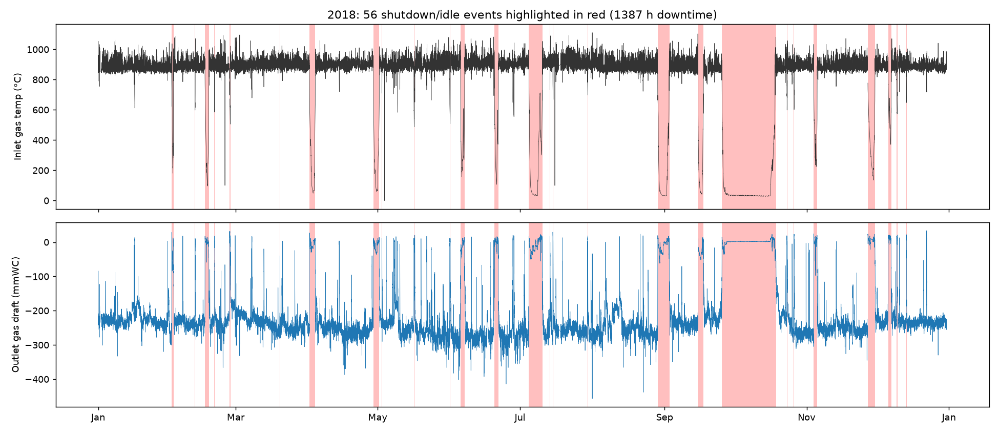
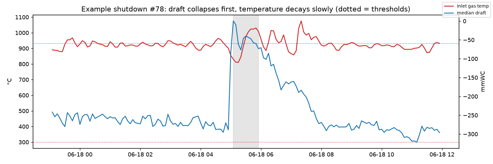
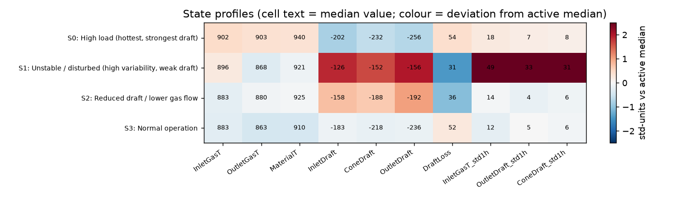
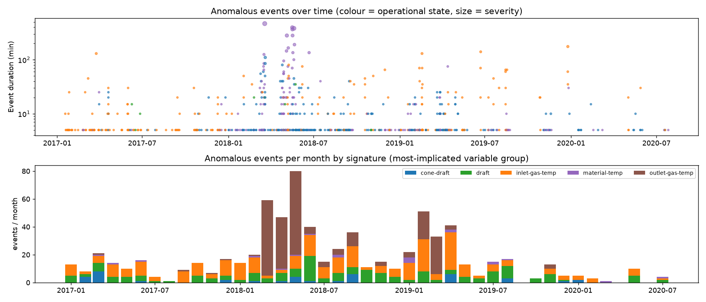
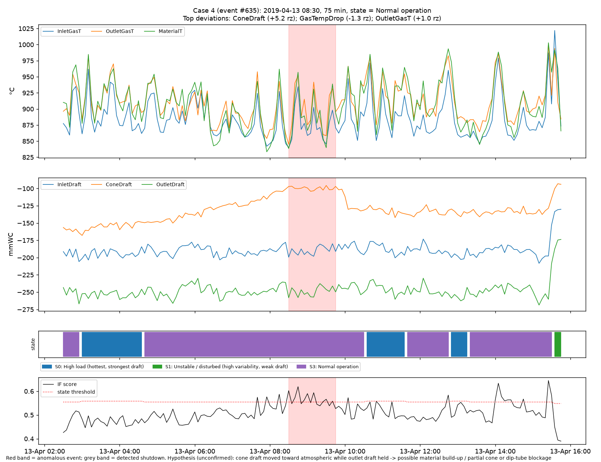
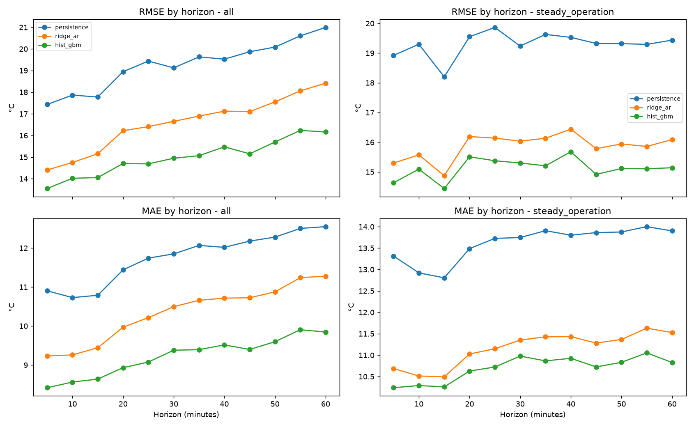
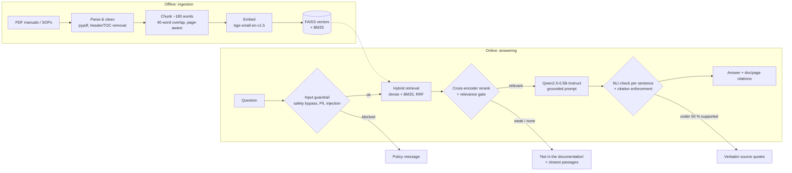

# Cyclone operations analytics & documentation RAG assistant

**Data Science take-home: Prajot Shrivastava**

| | |
|---|---|
| **Task 1: time-series analytics** | 3.6 years of 5-minute cyclone sensor data → data cleaning, shutdown detection, operating states, state-aware anomaly detection with root-cause hypotheses, 1-hour forecasting |
| **Task 2: RAG system** | Question answering over 11 real cyclone manuals and SOPs, with page-level citations, guardrails and evaluation. Open-source models only; runs on a laptop CPU. |

📊 Slides: [`Final_Presentation.pptx`](Final_Presentation.pptx) · 🧭 Architecture: [`Task2/architecture_diagram.pptx`](Task2/architecture_diagram.pptx) · 📄 Details: [`Task1/README.md`](Task1/README.md), [`Task2/notes.md`](Task2/notes.md), [`Task2/prototype/README.md`](Task2/prototype/README.md)

---

## At a glance

| Task 1 | Result |
|---|---|
| Shutdowns detected | **154 events · 6,840 h of downtime (21.7 % of the record)** |
| Operating states | **4**: high load, normal, reduced draft, unstable |
| Anomalous events | **746**, judged against their own operating state |
| 1-hour forecast (inlet gas temp) | **RMSE 15.0 °C** vs 19.3 °C for "no change" persistence (−22 %) |

| Task 2 | Result |
|---|---|
| Right passage in top 3 | **94 %** of 17 labelled questions |
| Guardrails | **4/4** out-of-scope questions refused, **4/4** unsafe prompts blocked, **0/17** valid questions refused |
| Answers | **100 %** carry citations; median **3.6 s** on CPU |

---

## Task 1: Cyclone sensor analytics

### 1. Data preparation

| Issue found | Treatment |
|---|---|
| 377,719 rows, 2017-01-01 → 2020-08-07. The only gaps are **31 Dec** of each year. | Re-gridded to a strict 5-min index; 861 missing slots → NaN |
| **8,195 cells of historian status text** (`Not Connect`, `I/O Timeout`, …) | → NaN |
| Saturated (1375 °C), negative and spike values; material temperature > 250 °C below gas temperature while running; values stuck for ≥ 3 h | → NaN |
| Statistical outliers | **Flagged, not deleted.** Extremes may be real process events, so they are left for the anomaly detector. |

### 2. Shutdown detection: draft first, not temperature

A point is "down" when **the median draft is above −60 mmWC (ID fan off)** or **inlet gas is below 300 °C**. Gaps under 30 min are merged, and stops shorter than 30 min are ignored.
When a stop happens, the draft collapses within minutes, but the gas stays hot for hours. A temperature-only rule would count the cooling period as running.



<details><summary>Why draft beats temperature (example stop)</summary>


</details>

**Downtime:** 33 stops longer than 24 h hold about **95 % of downtime**; the other 121 are short trips and stops. **30.5 % of restarts** are followed by another stop within 24 h.

### 3. Operating states (clustering)

KMeans on 1-hour regime features: the means of the 6 sensors, the cyclone pressure drop, and variability. Only running data is used.
I chose **k = 4** over the silhouette-optimal k = 3 because it separates a hotter, stronger-draft regime. Higher k split off sensor faults, which are now removed during cleaning.



| State | % of running time | Median episode | Anomaly events / 1000 h |
|---|---|---|---|
| High load (hottest, strongest draft) | 36.1 | 100 min | 33.4 |
| Unstable / disturbed | 2.4 | 65 min | 22.0 |
| Reduced draft / lower gas flow | 33.6 | 108 min | 31.3 |
| Normal operation | 27.9 | 85 min | 27.3 |

### 4. State-aware anomaly detection + root causes

A **separate Isolation Forest is trained for each state**. A point is flagged when its score is in the top 1 % for its state **and** a variable sits more than 5 robust-σ from that state's median, **or** when any single sensor deviates by more than 10 robust-σ. Flagged points are merged into events, each with its most-implicated sensors and context (before a stop / after a restart / steady).



Five case studies, one per failure signature. **These are hypotheses from sensor data only; nothing was validated against operator logs.**

| # | What the data shows | Hypothesis |
|---|---|---|
| 1 | Material temp reads a perfectly flat 650 °C while everything else is normal | Signal fault / substituted value |
| 2 | Outlet gas reads 400 °C below inlet for ~8 h, with drafts unchanged (156 such events in Mar–Jun 2018) | Outlet thermocouple degradation |
| 3 | Inlet temp reads 0 °C, then a flat 800 °C, while the process clearly kept running | Transmitter / wiring fault |
| 4 | **Cone draft creeps from −160 to −100 mmWC over 6 h** while the other drafts hold, then steps back | **Cone build-up / partial blockage, partly cleared** |
| 5 | Restart where the draft never reached normal, then a second stop | Aborted first restart attempt |



### 5. 1-hour forecast of inlet gas temperature

Train on 2017–2019, test on Jan–Aug 2020 (5,193 hourly forecast origins × 12 steps). Shutdowns are kept in the test set, as they would be in real use.

| Model | RMSE all | MAE all | RMSE steady | RMSE around stops/starts |
|---|---|---|---|---|
| Persistence ("no change") | 19.3 | 11.8 | 19.3 | 19.3 |
| Ridge AR-X | 16.6 | 10.3 | 15.9 | 19.3 |
| **HistGradientBoosting** | **15.0** | **9.2** | **15.1** | **14.5** |



The linear model gains nothing around stops and starts; trees handle the regime switch using on/off flags. Even 5 minutes ahead, the error stays around 14–17 °C, because the signal itself carries about ±15 °C of noise.

### Insights → recommendations

1. **The worst anomalies are instrument faults, not process faults.** → Add instrument-health rules: flat-line detection, exact-0 / substituted values, and *outlet gas within ~50 °C of inlet while running*.
2. **Anomalies are ~12× more frequent in the 2 h before a stop** (12.9 % of events vs 1.1 % of running time), and 57.8 % of stops had one beforehand. → This is a candidate early-warning signal on draft weakening, still to be validated against stop causes.
3. **Cone choking has a visible precursor.** → Add a trend alarm on (cone − outlet) draft, which would fire hours before a fixed threshold.
4. **Restarts are fragile** (30.5 % re-stop within 24 h). → Review the start-up procedure and record stop reason codes.
5. **The operating point drifts over the years** (the "reduced draft" state covers 80 % of 2017; "high load" covers 68 % of 2020). → Re-baseline models and thresholds quarterly.

---

## Task 2: RAG over cyclone documentation

The **11 PDFs from the assignment's Google Drive folder** (215 pages → 355 chunks) are indexed and queried locally, using only free, open-source models.

### Architecture



### Retrieval strategy & guardrails

| Concern | Approach |
|---|---|
| **Chunking** | Sentence-aware, about 180 words with a 40-word overlap, never crossing a page boundary, so every answer cites a document and page |
| **Retrieval** | BM25 + dense embeddings, fused with reciprocal-rank fusion, then a MiniLM cross-encoder rerank; the top 4 passages go to the LLM. Plant terms such as "draft" are expanded to manual terms such as "pressure differential". |
| **No answer** | A low rerank score returns "not in the documentation" **without calling the LLM**. Weakly related matches are quoted, not answered. |
| **Hallucination** | Every answer sentence must be **entailed (NLI) by the passage it cites**. Unsupported sentences are removed; if fewer than 50 % survive, the answer becomes verbatim quotes. |
| **Sensitive queries** | Interlock or safety bypass, harm, credentials/PII and prompt injection are blocked. Safety-critical topics are answered with a lock-out / permit-to-work note. |

### Evaluation

| Retriever (k = 3) | Precision@3 (doc) | Recall@3 (doc) | Hit@3 (passage) | MRR@10 |
|---|---|---|---|---|
| BM25 | 0.78 | 0.92 | 0.88 | 0.87 |
| Dense | 0.71 | 0.97 | 0.88 | 0.79 |
| Hybrid | 0.75 | 0.97 | 0.94 | 0.88 |
| **Hybrid + rerank (used)** | **0.77** | **0.98** | **0.94** | 0.85 |

End to end with Qwen2.5-0.5B on 17 questions:
- **Citations:** every answer is cited, and 94 % cite a relevant document.
- **Faithfulness:** only 73 % of the small model's draft sentences were supported by the sources; the NLI filter removes the rest. 76 % of answers are kept as generated, and 24 % fall back to quotes.

Example: *"What does a sudden draft drop indicate?"* No manual covers it directly, so the system says so and quotes the closest pressure-differential passages instead of guessing (see [`demo_output.txt`](Task2/prototype/demo_output.txt)).

### Scaling plan

| 10× documents | 100+ concurrent users | Cost control |
|---|---|---|
| ~35–50k chunks is still small for a vector DB. Incremental ingestion by document hash; HNSW (Qdrant / pgvector) with metadata filters; OCR and a layout parser for scans and tables. | Stateless retrieval pods autoscale on CPU. The LLM runs on vLLM with continuous batching and a 7–8B AWQ model on 24 GB GPUs. Semantic cache and rate limits. Load-test before sizing. | Serverless ingestion and retrieval; GPU pool sized for the peak shift; spot instances for re-indexing; extractive / small-model routing for simple look-ups. |

---

## Run it yourself

Requirements: Python 3.10+ (tested on 3.14, macOS, CPU only), about 3 GB RAM, and about 1.5 GB of model downloads on the first Task 2 run.

```bash
git clone https://github.com/PrajotShrivastava/Prajot_Shrivastava_DataScience.git
cd Prajot_Shrivastava_DataScience
python3 -m venv .venv && source .venv/bin/activate
pip install -r Task1/requirements.txt -r Task2/prototype/requirements.txt python-pptx==1.0.2

python Task1/task1_analysis.py                 # ~1.5 min → CSVs, plots/, outputs/

cd Task2/prototype
python rag_prototype.py ingest                 # rebuild the index (prebuilt copy included)
python rag_prototype.py ask "What is roping in a cyclone and why is it undesirable?"
python rag_prototype.py chat                   # interactive
python evaluate.py --llm qwen                  # retrieval + guardrail + end-to-end metrics
cd ../..

python presentation/make_slides.py             # rebuild both decks from the result files
```

## Repository layout

```
├── Final_Presentation.pptx        8-slide summary of both tasks
├── Task1/
│   ├── task1_analysis.py          full pipeline (deterministic, seed 42)
│   ├── shutdown_periods.csv · anomalous_periods.csv · clusters_summary.csv · forecasts.csv
│   ├── plots/                     22 figures
│   ├── outputs/                   data-quality report, metrics, per-timestamp labels, run log
│   └── README.md                  full method + case-study details
├── Task2/
│   ├── architecture_diagram.pptx  architecture + deployment view
│   ├── notes.md                   design trade-offs, guardrails, monitoring, scaling
│   └── prototype/                 rag_prototype.py · evaluate.py · docs/ (11 PDFs) · index/ · results
└── presentation/make_slides.py    generates the decks from the outputs
```

## Limitations

- **Task 1:** there were no operator or maintenance logs, so shutdown causes and anomaly root causes are hypotheses. The clustering silhouette is low (the states are regimes on a continuum, not separate clusters).
- **Task 2:**
  - The evaluation set is small (17 + 4 + 4 prompts), labelled by me, and the thresholds were set by inspecting it.
  - The safety policy is regex-based.
  - 18 image-only PDF pages are not OCR'd.
